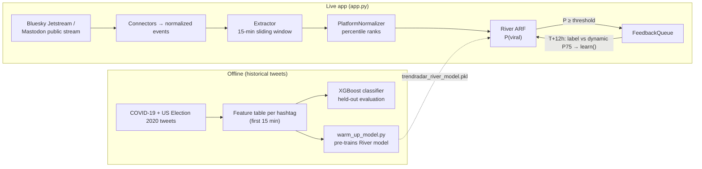

# TrendRadar

**Predict whether a topic will go viral in the next 12 hours from only its first 15 minutes of activity, then keep learning online from live Bluesky and Mastodon streams.**

> 🇫🇷 **Résumé** — TrendRadar prédit si un hashtag deviendra viral dans les 12 h à partir de ses 15 premières minutes d'activité seulement (XGBoost, ROC-AUC 0,921 sur données Twitter COVID-19 et élections US 2020). Une seconde version apprend en continu (River, Adaptive Random Forest + ADWIN) sur les flux publics Bluesky et Mastodon, avec un tableau de bord Streamlit. Projet d'équipe EMSI (4 personnes), dont j'ai dirigé l'implémentation et l'architecture.

## Demo

<!-- TODO: live Streamlit URL — ask Adil -->

<!-- TODO: add screenshot of the dashboard while streaming (metric cards, trend feed, stream log) -->
<!-- TODO: add screenshot of the Propagation Explorer (BFS layers + PageRank-coloured reshare graph) on a Mastodon keyword -->

## The problem

Newsrooms, brand teams and moderators all want the same thing: to know which topic is about to blow up *before* it does. By the time a hashtag is in the "trending" list the window to react has closed. TrendRadar asks a narrower, testable question: given only the first 15 minutes of a hashtag's life, can we tell whether its 12-hour volume will land in the top quarter? Then, since what goes viral shifts over time, it asks whether a model can keep adapting on a live stream instead of being retrained by hand.

## Approach



**1. Offline model (XGBoost).** Historical tweets were grouped by hashtag: a COVID-19 corpus (Jul–Aug 2020) and two US Election 2020 corpora (Trump, Biden). Each hashtag's clock starts at its first appearance (T0). Hashtags with at least 3 tweets in the first 15 minutes were kept, giving 1,443 hashtags (425 COVID-19, 1,018 election), about 26% of them viral. A hashtag is labelled **viral** if its volume at T0 + 12 h is at or above the 75th percentile of all 12-hour volumes (P75; 9 tweets on the COVID-19 corpus). Each hashtag is described only by what happened in its first 15 minutes:

| Feature | What it measures |
|---|---|
| `velocity` | Number of posts in the 15-minute window |
| `burst_score` | Acceleration: posts in the second 7.5-min half vs the first, `(v2 − v1) / √(v1 + ε)` |
| `organic_ratio` | Unique authors ÷ posts (many people vs one account repeating itself) |
| `geo_score` | Number of distinct author locations (Twitter's free-text `user_location`) |
| `max_followers_log` | Reach of the biggest account involved, `log(1 + max followers)`, renamed `max_authority_log` in the live app |

These five were kept from a larger set of candidate features. The model was evaluated on a stratified 80/20 train/test split. The trained model is kept in `trendradar_xgb_model.pkl`, with its feature list and 0.40 decision threshold in `trendradar_config.pkl`. The live app does not load either file.

**2. Online model (River).** The live app swaps XGBoost for River's **Adaptive Random Forest** (10 trees, ADWIN drift detectors), which can learn one example at a time and adapt when the data drifts. `warm_up_model.py` pre-trains it on the same historical feature tables before deployment.

**3. Live pipeline.**
- **Connectors** (`connectors/`) turn platform events into one common format. Bluesky uses the public Jetstream WebSocket (no auth). Mastodon uses the public streaming API (token required).
- **Extractor** keeps a 15-minute sliding window per keyword and computes the five features above, plus a sixth: `max_pagerank`, the highest PageRank in the keyword's **reshare graph** (resharer → original author, built with networkx). A keyword is scored once it has at least 3 events and a velocity above 5.
- **PlatformNormalizer** converts each raw feature into its percentile rank within that platform's recent history, so "high velocity" means the same thing on a small and a large network.
- **FeedbackQueue** closes the loop. Each keyword flagged above the threshold is stored with its features. 12 hours later its volume is compared with a **dynamic P75 threshold** (computed from observed 12-hour volumes), and the resulting label is passed to `model.learn()`.
- **Propagation Explorer** in the dashboard runs a BFS over the reshare graph (original authors → 1st relay → 2nd relay…) and draws it with nodes sized by PageRank.

## Results

Offline model: XGBoost on the combined dataset (COVID-19 + US Election 2020), held-out test set, decision threshold 0.40.

| Metric | Value | What it measures |
|---|---|---|
| ROC-AUC | **0.921** | How well the model ranks viral above non-viral hashtags, at any threshold |
| Recall | 0.813 | Share of truly viral hashtags the model flags |
| Precision | 0.725 | Share of flagged hashtags that really went viral |
| F1 | 0.767 | Harmonic mean of precision and recall |

Feature importance (XGBoost, five offline features):

| Feature | Importance |
|---|---|
| velocity | 34.1% |
| burst_score | 20.5% |
| organic_ratio | 20.0% |
| geo_score | 12.7% |
| max_followers_log | 12.6% |

Online model: River ARF, **prequential ROC-AUC 0.830** after 1,443 examples (`warm_up_model.py`). Prequential means each example is predicted first and learned right after, so the score covers the model's whole learning curve, including its early mistakes. **It is not directly comparable to the 0.921 above**, which comes from a model trained once and evaluated on a held-out test set.

> The feature-importance panel in the dashboard sidebar is **hard-coded** in `app.py`. Its `max_pagerank` bar is a placeholder, not a measured importance: `max_pagerank` didn't exist in the historical data.

## Tech stack

Python · XGBoost · River (online learning) · scikit-learn · pandas · NumPy · networkx (PageRank, reshare graph) · Streamlit · Plotly · websockets (Bluesky Jetstream) · Mastodon.py · BeautifulSoup

## Run locally

Requires Python 3.11+ (the pinned NumPy 2.4 needs it).

```bash
git clone https://github.com/Adil-Bouhoum/TrendRadar.git
cd TrendRadar
python -m venv .venv
# Windows: .venv\Scripts\activate    macOS/Linux: source .venv/bin/activate
pip install -r requirements.txt
cp .streamlit/secrets.toml.example .streamlit/secrets.toml   # Windows: copy .streamlit\secrets.toml.example .streamlit\secrets.toml
streamlit run app.py
```

The secrets file must exist even if you leave the token empty: `app.py` reads `st.secrets` at startup, and Streamlit raises an error when no secrets file is found.

Pick **Bluesky** in the sidebar (no credentials needed) and click **Lancer le Scan**. For **Mastodon**, create an access token on your instance (*Preferences → Development → New application*, `read` scope) and paste it as `MASTODON_TOKEN` in `.streamlit/secrets.toml`.

**Re-training the River model (optional).** `warm_up_model.py` expects the historical feature tables in a `Feature Tables/` folder **next to** the repo folder (`../Feature Tables/feature_table_model.csv`, `feature_table_trump.csv`, `feature_table_biden.csv`). Those tables, and the notebook that trained the XGBoost model, are **not included in this repository**. The app runs without them, using the committed `.pkl` files.

## Project structure

```
TrendRadar/
├── app.py                        # Streamlit dashboard + live scoring loop
├── extractor.py                  # 15-min sliding window, 6 features, reshare-graph PageRank
├── normalizer.py                 # per-platform percentile normalization + dynamic P75 threshold
├── feedback_queue.py             # delayed (T+12h) labels → online learning
├── model_manager.py              # River Adaptive Random Forest wrapper (predict / learn / save)
├── warm_up_model.py              # pre-trains the River model on historical feature tables
├── connectors/
│   ├── base.py                   # common event format
│   ├── bluesky_connector.py      # Jetstream WebSocket firehose
│   └── mastodon_connector.py     # Mastodon public stream
├── trendradar_river_model.pkl    # loaded by app.py
├── trendradar_normalizer.pkl     # loaded by app.py
├── trendradar_xgb_model.pkl      # offline XGBoost model (not loaded by the app)
├── trendradar_config.pkl         # offline feature list + 0.40 threshold (not loaded by the app)
├── .streamlit/config.toml        # dark theme
└── requirements.txt
```

## Limitations & next steps

- **The model never learns from its misses.** The feedback queue only stores keywords predicted *above* the threshold, so only positive predictions ever get a label. False negatives (topics that went viral without being flagged) never reach `learn()`, and recall can't be measured live. *Next:* also queue a random sample of below-threshold keywords.
- **Bluesky has no authority signal.** The Jetstream firehose doesn't include follower counts, so `max_authority_log` is a constant there. *Next:* a cached profile lookup per author.
- **`max_pagerank` doesn't influence predictions yet.** The committed `trendradar_river_model.pkl` and `trendradar_normalizer.pkl` were produced before `max_pagerank` was added, so the model was trained on the five offline features only. The historical data has no reshare graph anyway (`warm_up_model.py` sets the feature to 0). On Bluesky the graph is never filled: replies are flagged as reshares, but the original author isn't in the payload. The feature stays 0 there and the Propagation Explorer only works on Mastodon reblogs.
- **Live mode tracks words, not hashtags.** The connectors keep alphabetic words longer than 4 letters, with no stop-word filter. Tokens starting with `#` fail the `isalpha()` check, so hashtags are skipped, while the offline model was trained on hashtags.
- **Live features are proxies of the offline ones.** The extractor uses each event's `community` field for both `organic_ratio` and `geo_score`. On Mastodon that field is the account's instance domain, so both features count servers rather than individual authors or places. On Bluesky it's the author's DID, so both count unique contributors and neither measures geography.
- **Online learning isn't persisted.** Updates happen in memory and the app never calls `model.save()`, so a restart reverts to the warm-up model. Pending labels live in the Streamlit session, so a label only arrives if that session stays open for 12 hours.
- **The dynamic threshold starts on a proxy.** `warm_up_model.py` seeds the 12-hour volume history with 15-minute velocity because real 12-hour volumes aren't in the tables. The committed normalizer therefore starts at a viral threshold of 5 posts, and it only becomes a true P75 of 12-hour volume once enough live labels arrive.
- **The sidebar's "ROC-AUC (live)" starts at 0.000.** The prequential metric isn't saved with the model, so the panel shows 0.000 (rendered as `-0.000`) until the first live labels arrive. The "Accuracy" shown at startup is the warm-up's prequential accuracy.
- **Not reproducible from this repo alone.** The XGBoost training notebook and the feature tables aren't included, and there are no automated tests.

## Team & role

EMSI course project (May 2026), team of four: **Adil Bouhoum**, Achraf Abderazik, Ilias Ait Barrehil, Marouane El Mahlali.

**My role:** I led the implementation and the architecture of the system.

## Author

**Adil Bouhoum** · AI & Data Science engineering student, EMSI

[LinkedIn](https://www.linkedin.com/in/adil-bouhoum-b83129232) · [GitHub](https://github.com/Adil-Bouhoum)
